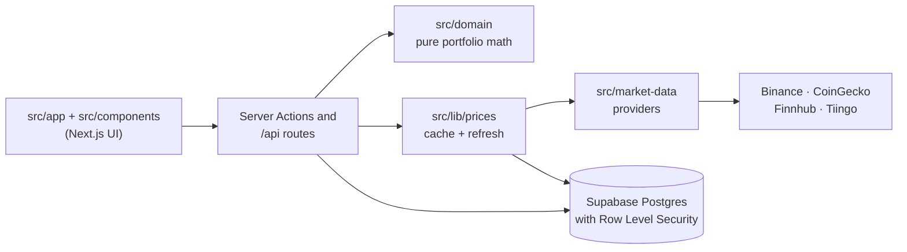

<div align="center">

# The Wire

**A personal investment ledger for stocks, ETFs and crypto.**<br>
Log what you bought at your real brokers and see holdings, average cost, live prices, profit and loss, and how it all moved over time.

[Live app](https://the-wire-seven.vercel.app) · [Features](#features) · [Getting started](#getting-started) · [How it works](#how-it-works) · [Roadmap](#roadmap)


</div>

> [!NOTE]
> The Wire is a **ledger, not a broker**. It never places orders, connects to broker or exchange accounts, or connects wallets, and nothing in it is financial advice. Prices come from third parties and may be late or wrong. See the in-app [legal notice](https://the-wire-seven.vercel.app/en/legal).

> [!IMPORTANT]
> Work in progress: milestones M1–M7 are done and M8 (settings and polish) is underway. See [`PLAN.md`](PLAN.md).

## Why The Wire

- **Your brokers stay where they are.** Keep buying at Nordnet, Binance or Coinbase, and see everything in one place.
- **Exact numbers.** Money and quantities are never JavaScript floats: Postgres `numeric` plus decimal.js, rounded only on screen.
- **Honest performance.** The chart's gain for a period leaves out the money you added, so buying more in a falling month shows a loss.
- **Private by default.** Each user sees only their own data (Row Level Security), there is no tracking or analytics, and one click hides every amount.

## Features

**Portfolio**
- Overview, Crypto and Stocks dashboards, each with summary cards, a performance chart and an allocation donut.
- Performance chart over 1W · 1M · 3M · 1Y · All. Click a holding in the allocation list to see its market price instead.
- Holdings table with average cost, live value and P/L, switchable between **Now** (what you hold) and **Total** (sales and dividends included).
- Projects to group transactions, like albums: long term, trading, a savings plan…

**Getting data in and out**
- Add buys, sells, dividends, rewards, deposits and withdrawals by hand, with asset search.
- Import CSV exports from **Nordnet**, **Binance** and **Coinbase**, or any broker through the [The Wire template](public/the-wire-template.csv). A review table shows every row before saving, and importing the same file twice never duplicates rows.
- **Export CSV** of the filtered transactions, in the template's format, so the file imports back.

**Prices**
- Live crypto over a Binance WebSocket and stocks refreshed every 30 seconds, with a shared server cache.
- Daily price history for the chart, split-adjusted, cached in the database.
- Manual prices for assets no provider covers.

**Privacy and settings**
- "Hide amounts" masks every amount and quantity; "Copy summary" shares results as text, with or without amounts.
- Settings for language and country / time zone. Dates are stored in UTC and shown in your time zone.
- Fully bilingual UI (English and Spanish) and email magic-link sign-in (no passwords).

## How it works



The code is split into layers that never mix:

- **`src/domain`**: pure portfolio math (cost basis, P/L, value series). No React, no network; every formula is unit-tested and explained in comments.
- **`src/market-data`**: price providers behind one interface. Pure parsers, tested with recorded response shapes.
- **`src/app` + `src/components`**: the UI. The session is checked in one place (`src/lib/auth.ts`).

### Data sources

| Provider | Used for | API key | Notes |
| --- | --- | --- | --- |
| [Binance](https://developers.binance.com/docs/binance-spot-api-docs) | Live crypto prices and daily crypto history | No | Market-data host; some regions are blocked, so CoinGecko backs it up |
| [CoinGecko](https://www.coingecko.com/en/api) | Crypto prices Binance doesn't list | Optional (free Demo) | |
| [Finnhub](https://finnhub.io) | Live US stock and ETF prices | Yes (free) | Can be up to ~15 min late; the free plan has no history |
| [Tiingo](https://www.tiingo.com) | Daily stock and ETF history | Yes (free) | Free plan: personal use only, 50 requests per hour |
| [Frankfurter](https://frankfurter.dev) | ECB exchange rates for imports | No | Converts EUR, DKK… to USD at the trade day's rate |

## Tech stack

- [Next.js 16](https://nextjs.org): App Router with Cache Components, Server Actions and a `proxy.ts` for routing
- [TypeScript](https://www.typescriptlang.org) and [React 19](https://react.dev)
- [Tailwind CSS 4](https://tailwindcss.com): design tokens in `src/app/globals.css` (see [`STYLE.md`](STYLE.md))
- [next-intl](https://next-intl.dev): English and Spanish routes (`/en`, `/es`)
- [Supabase](https://supabase.com): Postgres, email magic-link auth and Row Level Security
- [decimal.js](https://mikemcl.github.io/decimal.js/): exact money math
- [Vitest](https://vitest.dev): unit tests
- [Vercel](https://vercel.com): hosting, deploys `main` automatically

## Getting started

### Prerequisites

- Node.js 22 (`nvm use` reads [`.nvmrc`](.nvmrc))
- A free [Supabase](https://supabase.com) project
- Free API keys from [Finnhub](https://finnhub.io) and [Tiingo](https://www.tiingo.com) for stock prices (crypto works without keys)

### Setup

```sh
git clone https://github.com/Tomas-mazz/the-wire.git
cd the-wire
nvm use
npm install
cp .env.example .env.local   # then fill in the values below
npm run dev                  # http://localhost:3000 → redirects to /en or /es
```

**Database.** Apply the files in [`supabase/migrations/`](supabase/migrations) in order, either with the [Supabase CLI](https://supabase.com/docs/guides/cli) (`supabase link` then `supabase db push`) or by running each file in the SQL Editor of a fresh project. Every table has Row Level Security.

**Auth.** In Supabase → Authentication → URL Configuration, add `http://localhost:3000/**` to the redirect URLs. With the default email template, the sign-in link works in the browser where it was requested.

### Environment variables

| Variable | Required | Description |
| --- | --- | --- |
| `NEXT_PUBLIC_SUPABASE_URL` | Yes | Supabase project URL (public by design) |
| `NEXT_PUBLIC_SUPABASE_PUBLISHABLE_KEY` | Yes | Supabase publishable key (public by design; RLS protects the data) |
| `SUPABASE_SECRET_KEY` | For price caching | Server only. Writes the shared price caches (`latest_prices`, `price_history`) |
| `FINNHUB_API_KEY` | For stock prices | Server only. Live US stock and ETF prices |
| `TIINGO_API_KEY` | For stock history | Server only. Daily closes for the performance chart |
| `COINGECKO_API_KEY` | No | Server only. CoinGecko Demo key for the crypto fallback |

Never add the `NEXT_PUBLIC_` prefix to a server-only key. [`.env.example`](.env.example) explains where to get each one.

### Scripts

| Command | What it does |
| --- | --- |
| `npm run dev` | Start the dev server |
| `npm test` | Run the unit tests once (`npm run test:watch` to keep watching) |
| `npm run lint` | Lint with ESLint |
| `npm run build` / `npm start` | Production build and server (don't run `build` while `dev` is running: both write to `.next`) |

<details>
<summary><strong>Project structure</strong></summary>

```text
src/
├── app/
│   ├── [locale]/          # pages: landing, login, portfolio, settings, legal, news
│   ├── api/               # signed-in routes: prices, history, export, assets/search
│   └── auth/              # magic-link actions and callback
├── components/            # UI (portfolio/, settings/, auth/)
├── domain/                # pure portfolio math, unit-tested
├── market-data/           # price providers and parsers, unit-tested
├── lib/
│   ├── auth.ts            # the only place that checks the session
│   ├── import/            # broker file readers and review (pure, tested)
│   ├── export/            # CSV export (pure, tested)
│   ├── prices/            # price cache, history and manual prices
│   ├── settings/          # countries and time zones, settings form
│   └── supabase/          # server, proxy and admin clients
└── proxy.ts               # language routing, session refresh, auth redirects
messages/                  # UI strings: en.json and es.json
supabase/migrations/       # database schema (SQL)
```

</details>

## Deployment

Production runs on Vercel and deploys `main` on every merge. Add the Supabase URL and publishable key as **Config** variables and every server-only key as a **Secret**. The Supabase GitHub integration applies new files in `supabase/migrations/` when they reach `main`. Set the Supabase Site URL to the production URL and allow its `/**` redirect.

## Roadmap

- **M8, settings and polish (in progress):** settings page ✓, CSV export ✓, legal notice ✓, custom SMTP for sign-in emails, a week of real use.
- **v2:** AI import of screenshots and PDFs, insights (seasonality, drawdowns, volatility), split transactions, display currencies, non-US stocks.

The full spec and step-by-step milestones are in [`PLAN.md`](PLAN.md); every product decision is recorded in [`QUESTIONS.md`](QUESTIONS.md).

## Contributing

This is a personal project, but issues and suggestions are welcome. If you open a pull request, keep to the project's conventions:

- Work on a feature branch; commits follow [Conventional Commits](https://www.conventionalcommits.org) and everything committed is in English.
- Add every UI string to both `messages/en.json` and `messages/es.json`.
- Money and quantities use decimal strings and decimal.js, never floats; P/L and cost-basis changes need tests.
- Database changes go in a new file in `supabase/migrations/`; never edit one that is already merged.
- No order placement, broker or exchange trading APIs, or wallet connect.

[`AGENTS.md`](AGENTS.md) has the full engineering notes.

## Project docs

- [`IDEA.md`](IDEA.md): what The Wire is and why
- [`PLAN.md`](PLAN.md): tracker spec, data model and roadmap
- [`QUESTIONS.md`](QUESTIONS.md): every product decision
- [`STYLE.md`](STYLE.md): visual design guide
- [`AGENTS.md`](AGENTS.md): engineering notes and conventions

## License

No license has been chosen yet, so all rights are reserved by the author. Reading the code is welcome; ask before reusing it.
